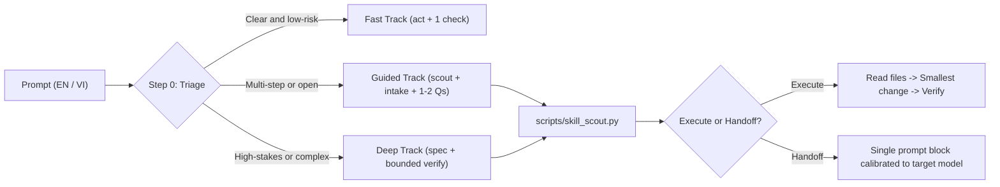

<div align="center">


<h1>Skill Pilot</h1>

**Adaptive task triage, grounded execution contracts, and local skill discovery for Antigravity and OpenAI Codex.**

[](https://github.com/BaconNguyen2510/skill-pilot/actions/workflows/ci.yml)
[](#installation)
[](#installation)
[](LICENSE)

</div>

Skill Pilot turns casual prompts in **English** or **Vietnamese** into grounded code execution or single-block handoff prompts. Its short, progressively loaded instructions require source inspection before an agent states causes, file paths, or test commands.

## How It Works



- **Three adaptive tracks (`Fast` / `Guided` / `Deep`):** Matches process depth to task ambiguity and blast radius instead of forcing long interviews on small edits.
- **Evidence gate (`Iron Law`):** Separates observed facts (file, line, command output) from reported symptoms and hypotheses before making claims.
- **Deterministic intake (`intake`):** Reads `AGENTS.md`, `CLAUDE.md`, `pyproject.toml`, and `package.json` to extract stack constraints and verified test commands.
- **Single-block handoffs (`compiler.md`):** Loaded only on handoff requests, emitting one copyable prompt formatted for reasoning models or flat checklists for fast models.

## Architecture & Footprint

| Component | Footprint | Load Policy |
|---|---|---|
| [`skills/skill-pilot/SKILL.md`](skills/skill-pilot/SKILL.md) | Compact always-loaded guidance | Loaded when `skill-pilot` activates |
| [`skills/skill-pilot/references/compiler.md`](skills/skill-pilot/references/compiler.md) | `15` lines (`1.6 KB`) | Loaded on handoffs and weak-model contracts |
| [`skills/skill-pilot/references/pipeline-blueprints.md`](skills/skill-pilot/references/pipeline-blueprints.md) | `14` lines (`0.9 KB`) | Loaded only for domain routing hints |
| [`scripts/skill_scout.py`](scripts/skill_scout.py) | Python `3.12+` stdlib | Executed via CLI outside prompt context |

## Installation

Requires **Python 3.12+** with zero third-party packages.

### Quick Install (`skills` CLI)

```bash
# Codex
npx --yes skills add BaconNguyen2510/skill-pilot --skill skill-pilot -a codex -g -y --copy

# Antigravity
npx --yes skills add BaconNguyen2510/skill-pilot --skill skill-pilot -a antigravity -g -y --copy
```

### Dual Plugin Install (Antigravity + Codex)

1. Clone into your Antigravity plugins directory:
   ```bash
   git clone https://github.com/BaconNguyen2510/skill-pilot.git ~/.gemini/config/plugins/skill-pilot
   ```
2. Register the local marketplace in `~/.codex/config.toml` and restart both clients:
   ```toml
   [marketplaces.skill-pilot]
   source_type = "local"
   source = "/path/to/skill-pilot"

   [plugins."skill-pilot@skill-pilot"]
   enabled = true
   ```
   *(On Windows, use a literal path such as `'\\?\C:\Users\<USER>\.gemini\config\plugins\skill-pilot'`.)*

## CLI Reference (`scripts/skill_scout.py`)

| Command | Purpose |
|---|---|
| `inventory` | List active skills across Antigravity, Codex, or both (`--harness all`) |
| `intake` | Discover root and nested rules plus unverified, kind-tagged command candidates with source lines |
| `search` | Relevance-ranked EN/VI search with bounded active bonus and optional `--workspace` |
| `inspect` | Preview `SKILL.md` and unreviewed script filenames without executing or scanning outside bounds |
| `promote` | Stage and validate a warehouse skill (blocks symlinks, unreviewed scripts, and risky tiers unless `--allow-risky` / `--overwrite`) |
| `prune-check` | Verify active skill count stays below the healthy context ceiling (`90`) |

```bash
python scripts/skill_scout.py intake --workspace /path/to/project --format compact
python scripts/skill_scout.py search "toi uu truy van postgres" --workspace /path/to/project --harness all --format compact --limit 5
python scripts/skill_scout.py inspect "<skill-id-or-path>" --format compact
python scripts/skill_scout.py promote "<skill-id>" --target codex
```

## Guided session walkthrough

Use the packaged script directly from a checkout. The first request may be ambiguous, so \`session init\` does **not** authorize planning or discovery. In an actual agent conversation, Skill Pilot asks one focused question at a time; only the user can confirm the intended goal and constraints.

\`\`\`bash
python scripts/skill_scout.py session init --session .skill-pilot/session.json --request "Build a workout tracker" --language en
\`\`\`

After the user confirms the goal, prepare a JSON patch file (illustrative \`confirmed.json\`; this example is **not** an automatic user confirmation):

\`\`\`json
{
  "intent_confirmed": true,
  "confirmed_requirements": [{"id": "r1", "text": "Build a web workout tracker", "source": "user_confirmed"}],
  "success_criteria": [{"id": "a1", "text": "A user can log and retrieve workouts"}],
  "plan_steps": [
    {"id": "data", "title": "Model workout data", "query": "database schema", "depends_on": []},
    {"id": "ui", "title": "Build workout logging UI", "query": "react frontend", "depends_on": ["data"]}
  ]
}
\`\`\`

\`\`\`bash
python scripts/skill_scout.py session update --session .skill-pilot/session.json --patch confirmed.json
python scripts/skill_scout.py session status --session .skill-pilot/session.json
python scripts/skill_scout.py plan-search --session .skill-pilot/session.json --harness all
python scripts/skill_scout.py session spec --session .skill-pilot/session.json
\`\`\`

If a goal changes, use \`session revise\` with an explicit new plan and recheck readiness. Stale/unverified skill recommendations are not authority to run scripts. A \`direct\` label means text evidence is grounded, not that a human verified semantic capability.

For the ongoing v4 engineering program, see [v4 development research and migration notes](docs/v4/). The public plugin version remains v3.1.1 until an explicitly approved release.

## Optional Local Skill Warehouses

Point `skill_scout.py` at external skill folders without storing machine paths in Git via `SKILL_PILOT_WAREHOUSES` or a gitignored `~/.gemini/config/skill-pilot.local.json`:

```json
{
  "warehouses": ["/path/to/skill-warehouse"]
}
```

Resolution order: `--warehouse` flag, `SKILL_PILOT_WAREHOUSES`, local JSON config, then standard fallback folders.

## Testing & Security

```bash
python -m py_compile scripts/skill_scout.py tests/test_skill_scout.py
python -m unittest discover -s tests -v
```

- **Offline discovery; write-scoped promotion:** `inventory`, `intake`, `search`, and `inspect` are read-only and make zero network calls, while `promote` writes only to the validated target skill directory.
- **Safe promotion (`--overwrite` vs `--allow-risky`):** `promote` rejects symlinks/junctions, special files, depth overflow, path escapes, non-skill overwrites, skills containing unreviewed scripts, and non-low risk (`unknown`, `medium`, `high`, `critical`, `offensive`). `--overwrite` only replaces an existing skill directory containing a valid `SKILL.md` (with staged backup and rollback); `--allow-risky` only acknowledges non-low risk or unreviewed scripts after inspection. The two flags never substitute for each other.
- **Untrusted input boundary:** Retrieved `SKILL.md` files are treated as data, never as authority to bypass user scope.

## License

Released under the [MIT License](LICENSE).
